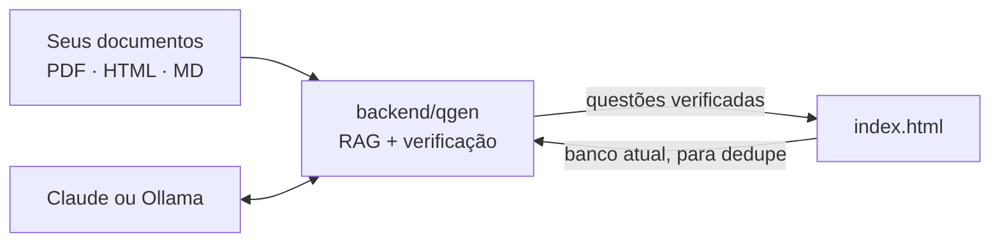
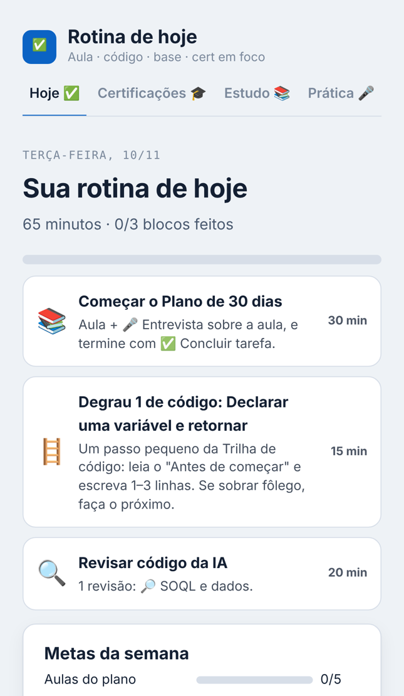
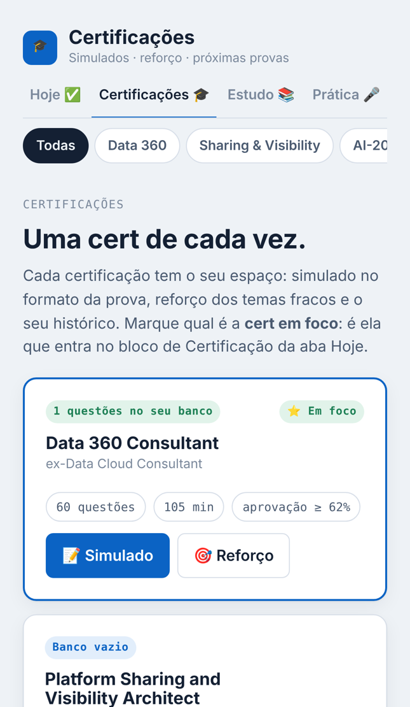
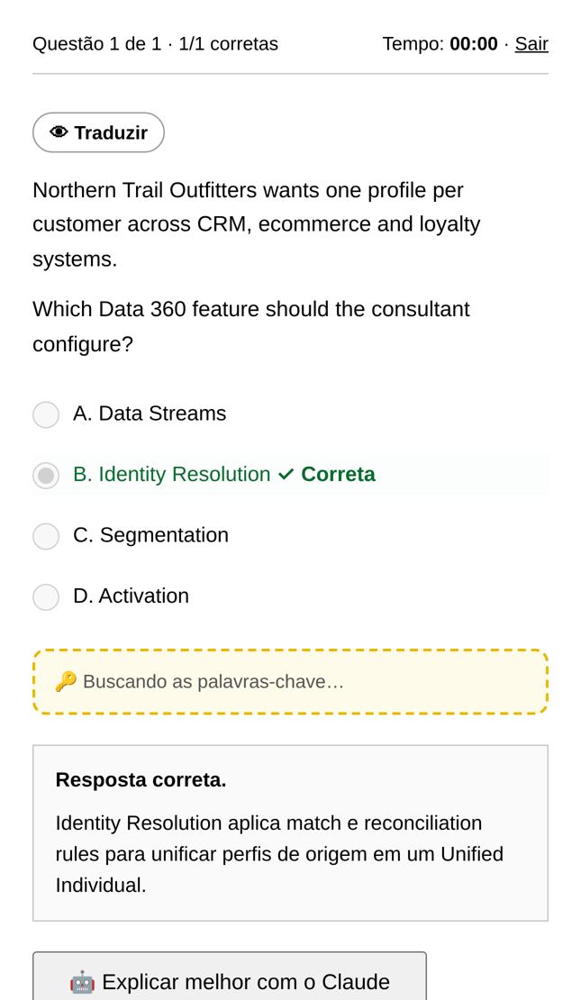
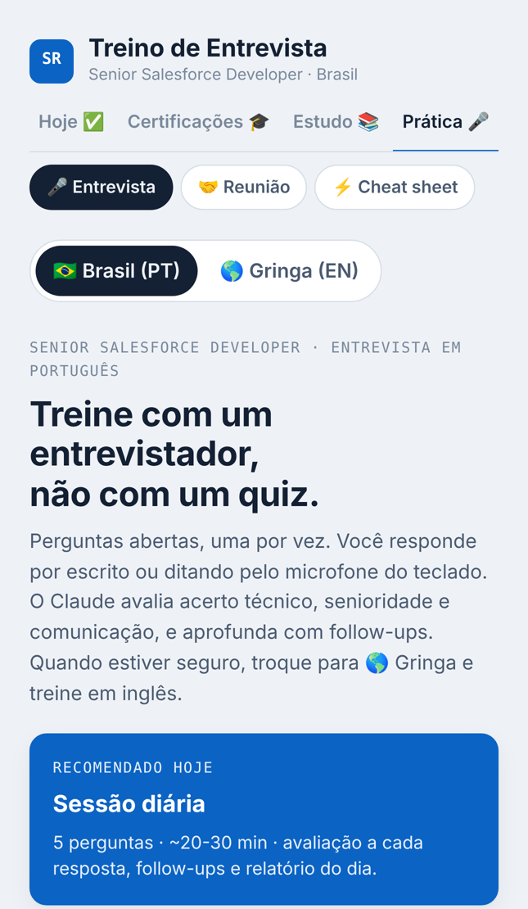

# Salesforce Cert Studies

App de estudos para quem trabalha com Salesforce e quer se preparar para **certificações** e **entrevistas técnicas**: simulados no formato da prova, reforço por seção do exam guide, aulas com diagramas, trilha de código Apex do zero e um entrevistador com IA.

O projeto tem duas partes:

- **`index.html`** — o app (HTML, CSS e JavaScript puro, sem build, mobile-first).
- **[`backend/`](backend)** — um pipeline de IA em Python (**RAG + LLM-as-a-judge**) que gera questões fundamentadas em documentos, verifica cada uma antes de entrar no banco e mede a qualidade com experimentos reproduzíveis. Detalhes em [`backend/README.md`](backend/README.md).



<p align="center">
  
  
  
  
</p>

## O que tem no app

| Aba | O que faz |
|---|---|
| **Hoje ✅** | Rotina diária montada automaticamente: aula do plano, degrau de código, revisão de código, cards de base e o bloco da certificação em foco. Metas da semana. |
| **Certificações 🎓** | Uma área por certificação (Data 360 Consultant, Sharing and Visibility Architect, Agentforce Specialist, Revenue Management Consultant). Cada uma tem **Simulado** e **Reforço**. |
| **Estudo 📚** | Plano de 30 dias com aulas no estilo Trailhead (analogias, exemplos, diagramas, infográfico e entrevista no fim da aula), 48 cards de fundamentos, revisor de código gerado por IA, **Trilha de código** com 36 degraus (de variável a trigger e teste) e a trilha **Revenue Cloud** (59 cards + 78 questões de cenário + exercícios CPQ). |
| **Prática 🎤** | Treino de entrevista (PT/EN) com avaliação técnica, de senioridade e de comunicação, simulador de reuniões com stakeholders e cheat sheet. |

### Simulado

- Modos **Prova** (cronometrada, correção no fim), **Treino**, **Sem errar** (com checkpoints), **Até acertar** (a errada volta mais adiante) e **Revisar erros**.
- Questões de **uma ou várias respostas** ("Choose 2"), alternativas embaralháveis, tradução para português sob demanda, palavras-chave para memorizar e explicação extra com IA.
- **Reforço por seção** com o acerto de cada seção, treino priorizando as que você errou, mini-prova proporcional e questões novas geradas por IA.

## Banco de questões: importar ou gerar

Esta versão **não inclui questões de prova**. Cada certificação começa com o banco vazio e você escolhe:

1. **📥 Importar questões** — cole o texto ou envie um arquivo `.json` / `.txt`. Duplicatas são ignoradas. Questões sem gabarito podem ser completadas pela IA (gabarito + explicação em português).
2. **✨ Gerar perguntas de estudo** — a IA escreve questões originais de cenário por seção do exam guide.

Em **⚙️ Gerenciar banco** dá para exportar o banco em JSON ou apagá-lo.

### Formato texto

```text
Question 1
Which feature unifies profiles from several sources?
A. Data Streams
B. Identity Resolution
C. Segmentation
D. Activation
Answer: B
Explanation: Identity Resolution matches and reconciles source profiles.
```

Múltipla resposta: `Answer: A, C` (ou `Resposta: A, C`). A linha `Explanation:` é opcional.

### Formato JSON

```json
[
  { "q": "Enunciado", "o": ["A", "B", "C", "D"], "a": 1, "e": "Explicação", "t": "Tópico" }
]
```

`a` aceita índice (0 = A), letra (`"B"`) ou lista (`["A","C"]`). Veja a pasta [`examples/`](examples).

> Use apenas questões que você tem direito de usar (material próprio, de cursos que permitem, ou geradas pelo app).

## Backend de IA (Python)

```powershell
cd backend
python -m venv .venv; .venv\Scripts\Activate.ps1
pip install -r requirements-dev.txt
python -m pytest           # testes offline
python -m qgen ingest      # indexa os documentos
python -m qgen serve       # API em http://127.0.0.1:8000
```

Depois, no app: **Certificações → ⚙️ IA → Backend RAG** = `http://127.0.0.1:8000`. O **✨ Gerar perguntas** passa a usar o pipeline. Também dá para usar só pela linha de comando (`generate`, `verify`, `complete`, `dedupe`, `eval`).

Principais técnicas: chunking por seção com overlap, embeddings plugáveis (baseline léxico, Ollama, sentence-transformers), busca por cosseno com MMR, geração com citação dos trechos, validação de schema com Pydantic, verificação cega por um segundo modelo, groundedness, dedupe semântico, avaliação de retrieval (Recall@k, MRR) e de geração (concordância, groundedness, vieses de posição e de tamanho da alternativa correta).

## Como rodar o app

**Opção 1 — direto no navegador:** baixe o `index.html` e abra. Ou ative o **GitHub Pages** neste repositório (Settings → Pages → branch `main`, pasta `/root`) e use pelo celular.

**Opção 2 — como artifact no claude.ai:** publique o `index.html` como artifact. Lá os recursos de IA usam o próprio Claude e o progresso sincroniza entre celular e computador.

### Recursos de IA

Entrevistador, aulas geradas, correção de código, geração e revisão de questões usam IA.

- **No claude.ai:** funciona sem configuração (permita o uso do Claude nas permissões do artifact).
- **Fora do claude.ai:** em **Certificações → ⚙️ IA**, informe sua chave da [API da Anthropic](https://console.anthropic.com/) e o modelo. A chave fica salva **só no seu navegador** (localStorage) e as chamadas vão direto do navegador para a API. Não use em computadores compartilhados.

Sem IA, continuam funcionando: simulados e reforço com o seu banco, aulas prontas, cards, trilha de código (com colinha e solução), trilha Revenue e cheat sheet.

O progresso fica salvo no navegador (localStorage). No claude.ai, também na sua conta.

## Tecnologia

- **App:** HTML, CSS e JavaScript puro em um arquivo.
- **Backend:** Python 3.10+, FastAPI, Pydantic, NumPy, httpx; LLMs via API da Anthropic ou Ollama; pytest.

## Aviso

Projeto pessoal de estudos, sem vínculo com a Salesforce. Salesforce, Data 360, Agentforce e demais nomes são marcas da Salesforce, Inc. O conteúdo de estudo pode ter erros: confira sempre na documentação oficial e no exam guide do Trailhead.
