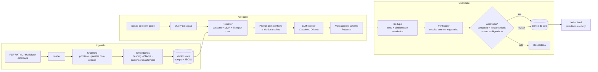

# qgen — geração e verificação de questões com RAG

Backend em Python do app **Salesforce Cert Studies**. Ele gera questões de certificação **fundamentadas em documentos** (RAG), verifica cada questão com um segundo modelo antes de ela entrar no banco e mede a qualidade do processo com experimentos reproduzíveis.

O problema que ele resolve: banco de questões de prova costuma ter gabarito errado, duplicatas e perguntas sem base na documentação. O `qgen` trata isso como um problema de engenharia de IA: recuperação de contexto, geração controlada, verificação independente e avaliação com métricas.

## Arquitetura



| Etapa | Arquivo | O que faz |
|---|---|---|
| Ingestão | `qgen/ingest.py` | Lê PDF, HTML, Markdown e TXT. Divide por títulos (guardando o caminho "Título > Seção") e em janelas de ~900 caracteres com overlap. A subpasta (`d360/`, `sva/`) define a certificação. |
| Embeddings | `qgen/embeddings.py` | Três opções com a mesma interface: **hashing** (baseline léxico, sem dependências), **Ollama** (`nomic-embed-text`) e **sentence-transformers**. |
| Vector store | `qgen/store.py` | Matriz numpy + metadados em JSONL. Busca por cosseno com **MMR** (Maximal Marginal Relevance) para diversificar o contexto. Interface pronta para trocar por FAISS, Chroma ou pgvector. |
| LLMs | `qgen/llm.py` | `AnthropicLLM` e `OllamaLLM` com a mesma interface, retry, contagem de tokens e latência, e parsing robusto de JSON. `FakeLLM` para testes. |
| Geração | `qgen/pipeline.py`, `qgen/prompts.py` | Monta a query da seção (nome + objetivos do exam guide), recupera o contexto, gera questões citando os ids dos trechos e valida o formato. |
| Verificação | `qgen/verify.py` | **LLM-as-a-judge**: outro modelo (ou o mesmo) responde sem ver o gabarito. Mede concordância, **groundedness** (apoio declarado + recall dos termos da resposta nos trechos citados) e ambiguidade. Classifica em aprovada, revisar ou rejeitada. |
| Dedupe | `qgen/dedupe.py` | Normalização de texto + similaridade de embeddings sobre "enunciado + resposta correta". |
| Avaliação | `qgen/evaluate.py` | Experimentos de retrieval (Recall@k, MRR) e de geração (ver abaixo), com relatório em Markdown e JSON. |
| API | `qgen/api.py` | FastAPI: `/health`, `/outlines`, `/generate`, `/verify`, `/complete`. Documentação automática em `/docs`. |
| CLI | `qgen/__main__.py` | `ingest`, `search`, `generate`, `verify`, `complete`, `dedupe`, `eval`, `eval-retrieval`, `serve`. |

## Como rodar (Windows / PowerShell)

```powershell
cd backend
python -m venv .venv
.venv\Scripts\Activate.ps1
pip install -r requirements-dev.txt
copy .env.example .env      # coloque sua ANTHROPIC_API_KEY ou use Ollama
python -m pytest            # 15 testes, rodam offline
python -m qgen ingest       # indexa data/docs (já vem uma amostra)
python -m qgen search "who wins first name when sources disagree" --cert d360
```

No macOS/Linux, ative o ambiente com `source .venv/bin/activate` e copie o `.env` com `cp`.

### Usando Ollama (grátis, local)

```powershell
ollama pull llama3.1:8b
ollama pull nomic-embed-text
# no .env: QGEN_PROVIDER=ollama e, se quiser embeddings semânticos, QGEN_EMBEDDER=ollama
python -m qgen ingest
```

### Gerar e verificar questões

```powershell
# 5 questões de Identity Resolution, verificadas pelo mesmo modelo
python -m qgen generate --cert d360 --section ir -n 5

# Todas as seções, escrevendo com Ollama e verificando com Claude
python -m qgen generate --cert d360 --section all -n 3 --provider ollama --judge anthropic

# Conferir um banco que você já tem (exportado do app em ⚙️ Gerenciar banco → Exportar JSON)
python -m qgen verify --cert d360 --bank questoes-d360.json

# Completar gabarito e explicação de questões importadas sem resposta
python -m qgen complete --cert d360 --bank sem-gabarito.json

# Remover duplicatas (inclusive paráfrases)
python -m qgen dedupe --bank questoes-d360.json
```

O resultado sai em `data/out/*.json`, no formato que o app importa em **Certificações → 📥 Importar questões**.

### Usar pelo app

```powershell
python -m qgen serve        # http://127.0.0.1:8000  (docs em /docs)
```

No app, vá em **Certificações → ⚙️ IA**, informe `http://127.0.0.1:8000` em **Backend RAG** e clique em **Testar conexão**. A partir daí, **✨ Gerar perguntas de estudo** usa o backend: as questões vêm fundamentadas nos seus documentos e só entram no banco depois de passar pelo verificador.

## Seus documentos

Coloque os arquivos em `data/docs/<cert>/`, por exemplo `data/docs/d360/exam-guide.pdf` ou `data/docs/sva/sharing-architecture.html`. Os ids das certificações estão em `data/exam_outlines.json` (`d360`, `sva`, `ai201`). Rode `python -m qgen ingest` de novo depois de adicionar arquivos.

A pasta `data/docs/sample/` traz notas de estudo curtas escritas para este projeto, só para o pipeline rodar sem baixar nada. O `.gitignore` deixa fora do Git qualquer outro documento seu.

## Avaliação

### Retrieval

```powershell
python -m qgen eval-retrieval --embedders hashing ollama
```

Usa `data/eval/retrieval.jsonl`: 30 consultas, cada uma rotulada com o documento e a seção relevantes do corpus de amostra. Com corpus pequeno e consultas parecidas com o texto, até o baseline léxico vai bem; o conjunto foi feito para ser ampliado com os seus documentos e consultas mais difíceis. Mede **Recall@1/3/5** e **MRR** para cada embedder.

### Geração

```powershell
python -m qgen eval --cert d360 --models anthropic ollama:llama3.1:8b --judge anthropic -n 3
```

| Métrica | O que mede |
|---|---|
| `schema_valid_rate` | Questões que passaram na validação (4 alternativas distintas, gabarito válido). |
| `citation_valid_rate` | Questões que citaram ids de trechos realmente recuperados. |
| `duplicate_rate` | Questões descartadas por serem duplicatas ou paráfrases. |
| `agreement_rate` | O juiz, sem ver o gabarito, escolheu a mesma resposta. |
| `grounded_rate` | A resposta correta está sustentada pelos trechos citados. |
| `ambiguous_rate` | O juiz considerou mais de uma alternativa defensável. |
| `acceptance_rate` | Passou em tudo: concorda, fundamentada e sem ambiguidade. |
| `longest_option_correct_rate` | Viés conhecido de LLMs de deixar a alternativa certa mais longa (o esperado ao acaso é ~0,25). |
| `answer_position_entropy` | Distribuição do gabarito entre A–D (1 = uniforme). |
| `tokens_in/out`, `seconds` | Custo e latência. |

Os relatórios ficam em `reports/`.

### Ideias de experimentos para o mestrado

- Embeddings léxicos x semânticos e o efeito do MMR na diversidade das questões.
- Tamanho de chunk e overlap x groundedness.
- Modelo pequeno local (Ollama) escrevendo + modelo grande verificando x um único modelo grande.
- Concordância do juiz automático com a revisão humana em uma amostra rotulada à mão.
- Mitigar os vieses de posição e de tamanho da alternativa correta (embaralhar, pedir alternativas com tamanho parecido) e medir a diferença.

## Testes

`python -m pytest` roda 15 testes **sem rede e sem chave**, usando `FakeLLM` e o embedder de hashing. Eles cobrem chunking, vector store e filtro por cert, retrieval, validação de schema, parsing de JSON com retry, pipeline completo (geração, validação, verificação, dedupe), conclusão de gabarito, ida e volta no formato do app, API e relatório de avaliação.

## Limitações

- O vector store em memória é pensado para alguns milhares de trechos. Para corpus maiores, troque por FAISS ou pgvector (mesma interface).
- O verificador é um LLM e pode errar junto com o escritor, principalmente quando os dois são o mesmo modelo. Por isso as questões "para revisar" entram marcadas no banco.
- O recall léxico do groundedness é uma aproximação. Em português e com sinônimos ele subestima o apoio real.
